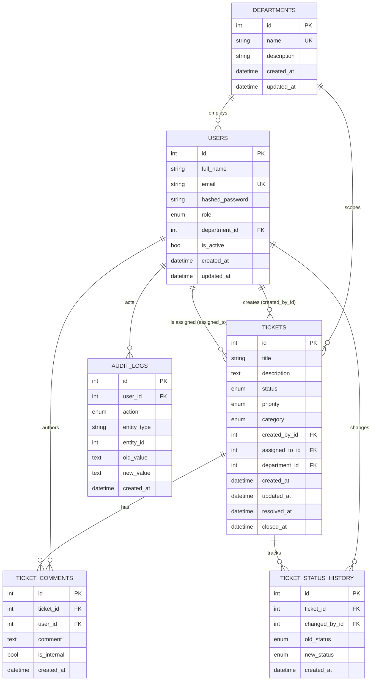

# Database Schema

Reference for the PostgreSQL schema behind the **Internal Ticketing & Support Management System**.
Models are defined with SQLAlchemy 2.0 (`Mapped` / `mapped_column`) under `backend/app/models/` and the
schema is created at startup via `Base.metadata.create_all` (Alembic is configured, but no migration
scripts have been written yet).

- [Conventions](#conventions)
- [Entity-Relationship Diagram](#entity-relationship-diagram)
- [Tables](#tables)
  - [users](#users)
  - [departments](#departments)
  - [tickets](#tickets)
  - [ticket_comments](#ticket_comments)
  - [ticket_status_history](#ticket_status_history)
  - [audit_logs](#audit_logs)
- [Relationships summary](#relationships-summary)
- [Enumerated types](#enumerated-types)

---

## Conventions

- **Primary keys** — every table has an auto-incrementing integer `id`.
- **Enums** — stored as strings via SQLAlchemy `Enum(..., native_enum=False)`, so the column holds the
  exact lowercase value (e.g. `in_progress`), not a Postgres native enum type.
- **Timestamps** — timezone-aware `DateTime(timezone=True)`. `created_at` defaults to `now()`;
  `updated_at` defaults to `now()` and updates on every write (`onupdate=now()`).
- **Deletes** — a ticket's `comments` and `status_history` are cascade-deleted with the ticket;
  departments cannot be deleted while referenced by users or tickets (enforced in the service layer).

---

## Entity-Relationship Diagram

> To embed this as an image, render the block above with the Mermaid CLI and save it to
> `docs/database-erd.png`.

---

## Tables

### users
Accounts that authenticate and interact with the system.

| Column | Type | Constraints | Notes |
|---|---|---|---|
| `id` | integer | PK | |
| `full_name` | varchar(120) | not null | |
| `email` | varchar(255) | unique, indexed, not null | login identifier |
| `hashed_password` | varchar(255) | not null | bcrypt hash |
| `role` | enum `UserRole` | not null, default `employee` | stored as string |
| `department_id` | integer | FK → `departments.id`, nullable | |
| `is_active` | boolean | default `true` | inactive users are rejected at login |
| `created_at` | timestamptz | server default `now()` | |
| `updated_at` | timestamptz | default `now()`, on update `now()` | |

**Relationships:** `department` → `Department`; `created_tickets` → `Ticket` (via `created_by_id`);
`assigned_tickets` → `Ticket` (via `assigned_to_id`).

### departments
Organisational units used to scope users and tickets.

| Column | Type | Constraints | Notes |
|---|---|---|---|
| `id` | integer | PK | |
| `name` | varchar(100) | unique, not null | |
| `description` | varchar(255) | nullable | |
| `created_at` | timestamptz | server default `now()` | |
| `updated_at` | timestamptz | default `now()`, on update `now()` | |

**Relationships:** `users` → `User`; `tickets` → `Ticket`.

### tickets
The core work item.

| Column | Type | Constraints | Notes |
|---|---|---|---|
| `id` | integer | PK | |
| `title` | varchar(200) | not null | |
| `description` | text | not null | |
| `status` | enum `TicketStatus` | default `open` | |
| `priority` | enum `TicketPriority` | default `medium` | |
| `category` | enum `TicketCategory` | not null | |
| `created_by_id` | integer | FK → `users.id`, not null | requester |
| `assigned_to_id` | integer | FK → `users.id`, nullable | support owner |
| `department_id` | integer | FK → `departments.id`, nullable | |
| `created_at` | timestamptz | server default `now()` | |
| `updated_at` | timestamptz | default `now()`, on update `now()` | |
| `resolved_at` | timestamptz | nullable | stamped on → `resolved` |
| `closed_at` | timestamptz | nullable | stamped on → `closed` |

**Relationships (two user FKs disambiguated via `foreign_keys`):** `created_by` → `User`;
`assigned_to` → `User`; `department` → `Department`; `comments` → `TicketComment` (cascade
all/delete-orphan, ordered by `created_at`); `status_history` → `TicketStatusHistory` (cascade, ordered
by `created_at`).

### ticket_comments
Conversation and private internal notes on a ticket.

| Column | Type | Constraints | Notes |
|---|---|---|---|
| `id` | integer | PK | |
| `ticket_id` | integer | FK → `tickets.id`, not null | |
| `user_id` | integer | FK → `users.id`, not null | author |
| `comment` | text | not null | |
| `is_internal` | boolean | default `false` | hidden from employees when `true` |
| `created_at` | timestamptz | server default `now()` | |

**Relationships:** `ticket` → `Ticket`; `user` → `User`.

### ticket_status_history
One immutable row per status transition, for an auditable workflow trail.

| Column | Type | Constraints | Notes |
|---|---|---|---|
| `id` | integer | PK | |
| `ticket_id` | integer | FK → `tickets.id`, not null | |
| `changed_by_id` | integer | FK → `users.id`, not null | actor |
| `old_status` | enum `TicketStatus` | nullable | `null` on creation |
| `new_status` | enum `TicketStatus` | not null | |
| `created_at` | timestamptz | server default `now()` | |

**Relationships:** `ticket` → `Ticket`; `changed_by` → `User`.

### audit_logs
Append-only record of significant actions across the platform.

| Column | Type | Constraints | Notes |
|---|---|---|---|
| `id` | integer | PK | |
| `user_id` | integer | FK → `users.id`, nullable | acting user (null for system/anon) |
| `action` | enum `AuditAction` | not null | e.g. `ticket_assigned`, `login` |
| `entity_type` | varchar(50) | not null | `ticket`, `user`, `department`, `comment` |
| `entity_id` | integer | nullable | id of the affected entity |
| `old_value` | text | nullable | before-state (where relevant) |
| `new_value` | text | nullable | after-state (where relevant) |
| `created_at` | timestamptz | server default `now()` | |

**Relationships:** `user` → `User`.

---

## Relationships summary

- **departments → users** (1‑to‑many): a department employs many users; a user belongs to at most one
  department (`users.department_id`, nullable).
- **departments → tickets** (1‑to‑many): a department scopes many tickets (`tickets.department_id`,
  nullable).
- **users → tickets** (two distinct 1‑to‑many): a user can be the **creator** of many tickets
  (`created_by_id`, required) and the **assignee** of many tickets (`assigned_to_id`, nullable). The two
  FKs are disambiguated in the ORM with explicit `foreign_keys`.
- **tickets → ticket_comments** (1‑to‑many): comments cascade-delete with their ticket.
- **tickets → ticket_status_history** (1‑to‑many): history rows cascade-delete with their ticket.
- **users → ticket_comments / ticket_status_history / audit_logs** (1‑to‑many): a user authors comments,
  performs status changes, and is the actor on audit entries (`audit_logs.user_id` is nullable).

---

## Enumerated types

All enum columns store the exact lowercase string values below (mirrored in
`frontend/src/types/enums.ts`):

| Enum | Column(s) | Values |
|---|---|---|
| `UserRole` | `users.role` | `employee`, `support`, `manager`, `admin` |
| `TicketStatus` | `tickets.status`, `ticket_status_history.old_status` / `new_status` | `open`, `in_progress`, `waiting_for_user`, `resolved`, `closed`, `cancelled` |
| `TicketPriority` | `tickets.priority` | `low`, `medium`, `high`, `critical` |
| `TicketCategory` | `tickets.category` | `hardware`, `software`, `network`, `email`, `account_access`, `security`, `other` |
| `AuditAction` | `audit_logs.action` | `ticket_created`, `ticket_updated`, `ticket_assigned`, `status_changed`, `priority_changed`, `ticket_deleted`, `comment_added`, `user_created`, `user_role_changed`, `user_deactivated`, `user_activated`, `department_created`, `department_updated`, `department_deleted`, `login` |

UI labels convert `snake_case` → Title Case (e.g. `in_progress` → "In Progress",
`account_access` → "Account Access").
